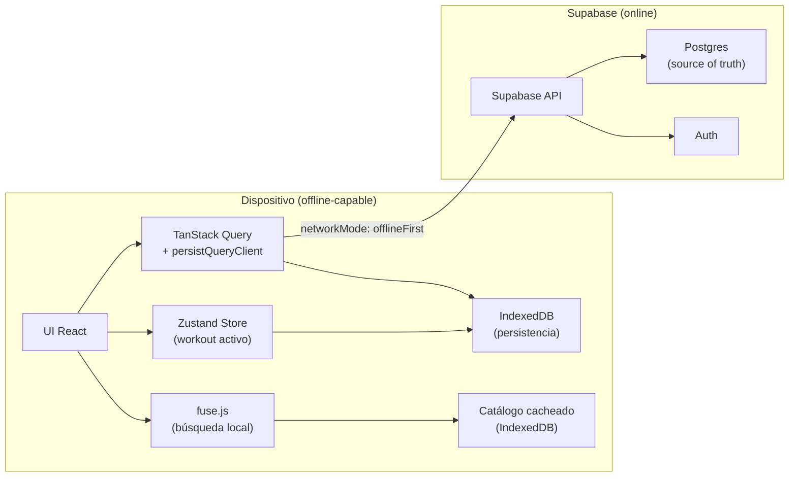
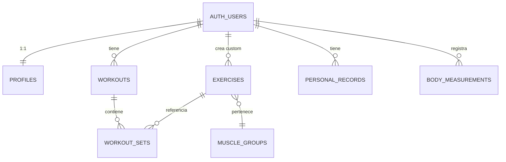

# 🏋️ GymTracker — Plan Único de Desarrollo

> Plan definitivo. Fusiona la claridad funcional de la v1 con las correcciones
> técnicas de la v2, más 5 parches propios detectados en revisión.
>
> **Seguimiento de tareas y evidencia: [`odd/tasks/gymtracker-mvp.md`](./odd/tasks/gymtracker-mvp.md).**
> Los checklists de §6 son de diseño; el estado real vive en el documento ODD.
>
> Última actualización: 2026-10-10.

---

## 1. Visión y alcance MVP

**GymTracker** es una PWA mobile-first multi-usuario para:

1. Registrar entrenamientos diarios (ejercicios × series × reps × peso), **incluso sin señal**.
2. Detectar PRs automáticamente (1RM estimado Epley).
3. Visualizar progreso por ejercicio (peso máx, volumen, 1RM).

**No-objetivos del MVP** (van a `BACKLOG.md`, no inflan el MVP):

- Social / compartir / amigos.
- Rutinas generadas con IA.
- Push notifications como dependencia funcional.
- Pagos / suscripciones.
- i18n (el schema deja `slug` preparado, nada más).

**Decisión explícita:** no Next.js. Es una SPA privada tras login; SSR no aporta
nada aquí y complica el offline. Vite + React basta.

---

## 2. Stack definitivo (sin "o", todo decidido)

| Capa | Tecnología | Por qué |
|------|-----------|---------|
| Lenguaje | TypeScript `strict` | Tipos generados del schema real vía `supabase gen types` |
| App | React 19 + Vite | SPA privada, ecosistema maduro |
| Routing | React Router v8 (`react-router`) | Simple, estable; no TanStack Router (innecesario aquí) |
| Server state | TanStack Query + `persistQueryClient` (IndexedDB) | Caché, reintentos y cola offline; **la cola necesita `shouldDehydrateMutation`, ver §3** |
| Client state | Zustand + `persist` (IndexedDB) | El workout activo sobrevive al cierre del browser |
| Forms | React Hook Form + Zod | Schemas Zod compartidos formularios ↔ validación |
| UI | Tailwind v4 (`@tailwindcss/vite`) + Radix (`@radix-ui/react-dialog`, `@radix-ui/react-toast`) | Accesibilidad lista sin reinventar |
| Gráficas | uPlot (`React.lazy()`) | ~10x más liviano que recharts; carga solo en detalle |
| DnD | dnd-kit (`React.lazy()`) | Soporte táctil nativo para reordenar |
| Animación | Motion, ex Framer Motion (`React.lazy()`) | Solo PR + transiciones, no en bundle inicial |
| Búsqueda | fuse.js sobre catálogo cacheado | Fuzzy search 100% offline |
| Fechas | date-fns (imports por función, tree-shaken) | — |
| Backend | Supabase (Postgres + Auth + Storage) | RLS, RPC, tipos, tier gratis |
| PWA | vite-plugin-pwa 2.x, `injectManifest`, `registerType: 'prompt'` | Control del SW; updates sin romper sesión en curso |
| Fuente | `@fontsource-variable/inter` autoalojada | Sin request externo ni bloqueo de render |
| Tests | Vitest + Testing Library + Playwright + test RLS 2 usuarios | El flujo crítico (Fase 3) es un e2e, no revisión manual |
| Errores | Sentry (tier gratis) | En móvil los errores son invisibles sin esto |
| CI | GitHub Actions: `lint → typecheck → test → build` | + preview URL por PR |
| Deploy | Vercel Hobby | **Si se monetiza → migrar a Cloudflare Pages** (Hobby prohíbe uso comercial) |

Región Supabase: **São Paulo** (menor latencia desde el cono sur).

> [!WARNING]
> Supabase Free pausa proyectos tras ~1 semana de inactividad. Verificar la
> política vigente en `supabase.com/pricing`. Mitigación: cron de health-check
> o uso regular.

### Dependencias instaladas (`package.json`)

> Estas son las versiones realmente resueltas e instaladas en Fase 0
> (`813f501`), no las estimadas durante el diseño. `package-lock.json` es la
> fuente de verdad para reproducir el árbol.

```json
{
  "dependencies": {
    "react": "^19.2.8",
    "react-dom": "^19.2.8",
    "react-router": "^8.4.0",
    "@supabase/supabase-js": "^2.117.3",
    "@tanstack/react-query": "^5.104.1",
    "@tanstack/react-query-persist-client": "^5.104.1",
    "idb-keyval": "^6.3.0",
    "zustand": "^5.0.15",
    "react-hook-form": "^7.89.0",
    "zod": "^4.6.5",
    "@hookform/resolvers": "^5.9.1",
    "date-fns": "^4.4.0",
    "fuse.js": "^7.5.0",
    "uuid": "^14.0.3",
    "@radix-ui/react-dialog": "^1.2.0",
    "@radix-ui/react-toast": "^1.2.24",
    "uplot": "^1.6.32",
    "@dnd-kit/core": "^6.3.1",
    "@dnd-kit/sortable": "^10.0.0",
    "motion": "^14.1.0",
    "@fontsource-variable/inter": "^5.3.0",
    "@sentry/react": "^11.6.0"
  },
  "devDependencies": {
    "vite": "^8.3.0",
    "typescript": "~6.0.2",
    "@vitejs/plugin-react": "^6.1.1",
    "vite-plugin-pwa": "^2.0.0",
    "workbox-build": "^7.4.1",
    "workbox-window": "^7.4.1",
    "@tailwindcss/vite": "^4.3.3",
    "tailwindcss": "^4.3.3",
    "vitest": "^5.0.3",
    "jsdom": "^30.1.2",
    "@testing-library/react": "^16.3.3",
    "@testing-library/jest-dom": "^7.0.1",
    "@playwright/test": "^1.64.0",
    "rollup-plugin-visualizer": "^7.1.1",
    "eslint": "^10.12.0",
    "@eslint/js": "^10.0.1",
    "typescript-eslint": "^8.71.1",
    "eslint-plugin-react-hooks": "^7.1.1",
    "eslint-plugin-react-refresh": "^0.5.7",
    "globals": "^17.13.0",
    "prettier": "^3.9.10",
    "husky": "^9.1.7",
    "lint-staged": "^17.6.0",
    "supabase": "^2.120.0"
  }
}
```

---

## 3. Arquitectura offline-first (decidida ANTES del core)

El gimnasio suele tener mala señal. Si anotar una serie depende de la red,
la app es frustrante. Retrofitear offline después es doloroso: se decide ahora.



| # | Principio | Implementación |
|---|-----------|----------------|
| 1 | Workout activo vive en local | Zustand + persist IndexedDB; sync al finalizar (o por serie en background) |
| 2 | IDs generados en cliente | `uuidv7()` de `uuid@^9` en cliente para workouts/sets/custom; `gen_random_uuid()` como default servidor (Postgres no genera v7 nativo). `crypto.randomUUID()` **no sirve: es v4** |
| 3 | Cola de mutaciones real | `networkMode: 'offlineFirst'` **en queries y en `defaultOptions.mutations`** + **`retry` > 0** + `persistQueryClient` con persister IndexedDB y `dehydrateOptions.shouldDehydrateMutation`. Ojo: el default de ese predicado **no es `false`**, es `mutation.state.isPaused`, y una mutación solo llega a pausada mientras hay un retry pendiente → con `retry: 0` la escritura offline termina en error, no se persiste y se pierde al recargar |
| 4 | Catálogo cacheado | TanStack Query + IndexedDB; búsqueda instantánea sin red con fuse.js |
| 5 | Guardado atómico | Un solo RPC `save_workout(payload jsonb)`: workout + sets + PRs en una transacción |
| 6 | Pesos siempre en kg | Columna `weight_kg`; conversión kg/lb **solo en UI**. Cambiar preferencia nunca toca el historial |
| 7 | Indicador de sync | Badge sutil de "pendiente de sincronizar", no bloqueante |
| 8 | Hidratación local explícita | Zustand `persist` con IndexedDB exige un `StateStorage` propio (el default es localStorage) y, al ser asíncrono, `skipHydration` + esperar `onRehydrateStorage` antes del primer render |
| 9 | Decimales parseados en un solo lugar | Las columnas `DECIMAL` (`weight_kg`, `best_1rm`, `total_volume`) vuelven como **string** desde supabase-js. Todo pasa por `src/lib/utils.ts`: nunca concatenar ni llamar `.toFixed()` sobre el valor crudo |

> Si la complejidad de sync supera a TQ, evaluar PowerSync/RxDB. Para v1 no.

### Limitaciones conocidas del MVP (documentadas, no bugs)

- **PRs monótonos:** `save_workout` reemplaza los sets completos, pero `personal_records`
  nunca baja. Editar o borrar la serie que logró el PR deja la marca vieja. Recalcular PRs queda post-MVP.
- **Edición concurrente:** dos dispositivos editando el mismo workout = last-write-wins con
  reemplazo total de sets, sin merge.
- **`ON CONFLICT DO UPDATE` no toca `date`:** un workout existente no puede re-fecharse vía `save_workout`.
- **`body_measurements` no tiene `deleted_at`**, a diferencia del resto; unicidad `(user_id, date)` y borrado duro.
- **Borrado de workout:** es soft delete (`deleted_at`); hoy ninguna fase expone la acción en UI.
- **La cola offline necesita un dispatcher global.** `dehydrateMutation` persiste solo `mutationKey`, `state`, `scope` y `meta`. Las funciones no sobreviven la serialización, así que una mutación restaurada **no tiene `mutationFn` propio**, mientras que `Mutation.continue()` llega a `execute()`, que lo necesita. La cola solo es reanudable si el cliente aporta un `mutationFn` por defecto que despache según el payload. Y como `MutationFunction` recibe únicamente las variables (no la `mutationKey`), **el payload tiene que ser autodescriptivo**: unión discriminada con `kind`.
- **Ventana de pérdida antes de que la escritura sea durable.** El retryer duerme el `retryDelay` **antes** de consultar si puede continuar y pausar, y el persister además tiene su propio throttle. Con el backoff por defecto (~2 s en el primer reintento) más el throttle (~1 s), una escritura offline tarda del orden de dos a tres segundos en quedar en disco: si el usuario cierra la pestaña en esa ventana, se pierde. Mitigación prevista: forzar un flush del persister en `pagehide`/`visibilitychange: hidden`.

---

## 4. Base de datos — Migraciones

Estructura en repo:

```
supabase/
├── config.toml
├── migrations/
│   ├── 0001_init.sql      # schema + RLS + índices + triggers + storage
│   └── 0002_rpcs.sql      # save_workout, exercise_progress, dashboard_summary, last_weight_for_exercise
└── seed.sql               # muscle_groups + catálogo ~48 ejercicios (NO en migraciones)
```

Flujo local: `supabase init` → `supabase start` (Docker) → `supabase db reset`
(ejecuta migraciones + `seed.sql`). Tipos: `supabase gen types typescript --local > src/types/database.ts`.

### 4.1 Diagrama de relaciones



Convención global: **soft delete** (`deleted_at`). Todo query de cliente filtra
`.is('deleted_at', null)`. RLS no lo filtra por vos.

### 4.2 Migración `0001_init.sql`

```sql
-- =============================================
-- GymTracker · 0001_init — schema + RLS + storage
-- =============================================

-- ---- Función propia para updated_at ----
-- (No depende de la extensión moddatetime, que puede no estar
-- habilitada en Supabase Cloud.)
CREATE OR REPLACE FUNCTION public.handle_updated_at()
RETURNS TRIGGER
LANGUAGE plpgsql AS $$
BEGIN
  NEW.updated_at = now();
  RETURN NEW;
END;
$$;

-- =============================================
-- profiles (1:1 con auth.users)
-- =============================================
CREATE TABLE public.profiles (
  id UUID PRIMARY KEY REFERENCES auth.users(id) ON DELETE CASCADE,
  username TEXT UNIQUE,
  full_name TEXT,
  avatar_url TEXT,
  weight_unit TEXT DEFAULT 'kg' CHECK (weight_unit IN ('kg', 'lb')), -- solo display
  created_at TIMESTAMPTZ DEFAULT now(),
  updated_at TIMESTAMPTZ DEFAULT now()
);

ALTER TABLE public.profiles ENABLE ROW LEVEL SECURITY;

CREATE POLICY "Users manage own profile"
  ON public.profiles FOR ALL
  USING ((select auth.uid()) = id)
  WITH CHECK ((select auth.uid()) = id);

CREATE TRIGGER trg_profiles_updated_at
  BEFORE UPDATE ON public.profiles
  FOR EACH ROW EXECUTE FUNCTION public.handle_updated_at();

-- =============================================
-- muscle_groups
-- =============================================
CREATE TABLE public.muscle_groups (
  id UUID PRIMARY KEY DEFAULT gen_random_uuid(),
  name TEXT NOT NULL UNIQUE,
  icon TEXT
);

ALTER TABLE public.muscle_groups ENABLE ROW LEVEL SECURITY;

CREATE POLICY "Anyone can read muscle groups"
  ON public.muscle_groups FOR SELECT USING (true);

-- =============================================
-- exercises — RLS separada por operación.
-- El catálogo global (is_custom=false) es read-only:
-- ningún usuario puede UPDATE/DELETE una fila global.
-- =============================================
CREATE TABLE public.exercises (
  id UUID PRIMARY KEY DEFAULT gen_random_uuid(),
  name TEXT NOT NULL,
  slug TEXT, -- reservado para i18n futuro
  muscle_group_id UUID REFERENCES public.muscle_groups(id),
  is_custom BOOLEAN DEFAULT false,
  created_by UUID REFERENCES auth.users(id),
  description TEXT,
  created_at TIMESTAMPTZ DEFAULT now(),
  deleted_at TIMESTAMPTZ
);

ALTER TABLE public.exercises ENABLE ROW LEVEL SECURITY;

CREATE POLICY "read exercises"
  ON public.exercises FOR SELECT USING (true);

CREATE POLICY "insert own custom"
  ON public.exercises FOR INSERT
  WITH CHECK (is_custom = true AND created_by = (select auth.uid()));

CREATE POLICY "update own custom"
  ON public.exercises FOR UPDATE
  USING (is_custom = true AND created_by = (select auth.uid()))
  WITH CHECK (is_custom = true AND created_by = (select auth.uid()));

CREATE POLICY "delete own custom"
  ON public.exercises FOR DELETE
  USING (is_custom = true AND created_by = (select auth.uid()));

-- =============================================
-- workouts — SIN constraint UNIQUE(user_id,date,title):
-- entrenar dos veces el mismo día con el mismo título es legítimo.
-- =============================================
CREATE TABLE public.workouts (
  id UUID PRIMARY KEY DEFAULT gen_random_uuid(),
  user_id UUID NOT NULL REFERENCES auth.users(id) ON DELETE CASCADE,
  date DATE NOT NULL DEFAULT CURRENT_DATE,
  title TEXT,
  notes TEXT,
  duration_minutes INT,
  created_at TIMESTAMPTZ DEFAULT now(),
  updated_at TIMESTAMPTZ DEFAULT now(),
  deleted_at TIMESTAMPTZ
);

ALTER TABLE public.workouts ENABLE ROW LEVEL SECURITY;

CREATE POLICY "Users manage own workouts"
  ON public.workouts FOR ALL
  USING ((select auth.uid()) = user_id)
  WITH CHECK ((select auth.uid()) = user_id);

CREATE TRIGGER trg_workouts_updated_at
  BEFORE UPDATE ON public.workouts
  FOR EACH ROW EXECUTE FUNCTION public.handle_updated_at();

-- =============================================
-- workout_sets — user_id DENORMALIZADO para RLS O(1)
-- (comparación directa en vez de subquery contra workouts).
-- weight_kg SIEMPRE en kg; la unidad preferida es solo display.
-- =============================================
CREATE TABLE public.workout_sets (
  id UUID PRIMARY KEY DEFAULT gen_random_uuid(),
  workout_id UUID NOT NULL REFERENCES public.workouts(id) ON DELETE CASCADE,
  user_id UUID NOT NULL REFERENCES auth.users(id) ON DELETE CASCADE,
  exercise_id UUID NOT NULL REFERENCES public.exercises(id),
  set_number INT NOT NULL,
  reps INT,
  weight_kg DECIMAL(6,2),
  rpe DECIMAL(3,1) CHECK (rpe >= 1 AND rpe <= 10),
  is_warmup BOOLEAN DEFAULT false,
  notes TEXT,
  created_at TIMESTAMPTZ DEFAULT now(),
  deleted_at TIMESTAMPTZ
);

ALTER TABLE public.workout_sets ENABLE ROW LEVEL SECURITY;

CREATE POLICY "Users manage own sets"
  ON public.workout_sets FOR ALL
  USING ((select auth.uid()) = user_id)
  WITH CHECK ((select auth.uid()) = user_id);

-- =============================================
-- personal_records — best_1rm con fórmula Epley: peso * (1 + reps/30)
-- =============================================
CREATE TABLE public.personal_records (
  id UUID PRIMARY KEY DEFAULT gen_random_uuid(),
  user_id UUID NOT NULL REFERENCES auth.users(id) ON DELETE CASCADE,
  exercise_id UUID NOT NULL REFERENCES public.exercises(id),
  best_1rm DECIMAL(6,2),
  max_weight_kg DECIMAL(6,2),
  max_reps_at_max_weight INT,
  achieved_at DATE NOT NULL,
  UNIQUE(user_id, exercise_id)
);

ALTER TABLE public.personal_records ENABLE ROW LEVEL SECURITY;

CREATE POLICY "Users manage own PRs"
  ON public.personal_records FOR ALL
  USING ((select auth.uid()) = user_id)
  WITH CHECK ((select auth.uid()) = user_id);

-- =============================================
-- body_measurements (Fase 6)
-- =============================================
CREATE TABLE public.body_measurements (
  id UUID PRIMARY KEY DEFAULT gen_random_uuid(),
  user_id UUID NOT NULL REFERENCES auth.users(id) ON DELETE CASCADE,
  date DATE NOT NULL,
  weight_kg DECIMAL(5,2),
  created_at TIMESTAMPTZ DEFAULT now(),
  UNIQUE(user_id, date)
);

ALTER TABLE public.body_measurements ENABLE ROW LEVEL SECURITY;

CREATE POLICY "Users manage own measurements"
  ON public.body_measurements FOR ALL
  USING ((select auth.uid()) = user_id)
  WITH CHECK ((select auth.uid()) = user_id);

-- =============================================
-- Índices
-- =============================================
CREATE INDEX idx_workouts_user_date ON public.workouts(user_id, date DESC);
CREATE INDEX idx_sets_user_exercise ON public.workout_sets(user_id, exercise_id, created_at DESC);
CREATE INDEX idx_sets_workout ON public.workout_sets(workout_id);
CREATE INDEX idx_exercises_muscle ON public.exercises(muscle_group_id);
CREATE INDEX idx_exercises_custom ON public.exercises(created_by) WHERE is_custom = true;
CREATE INDEX idx_pr_user ON public.personal_records(user_id);
CREATE INDEX idx_body_user_date ON public.body_measurements(user_id, date DESC);

-- =============================================
-- Auto-crear perfil al registrarse
-- (search_path fijo previene hijacking; SECURITY DEFINER requerido
-- porque el trigger corre sobre auth.users.)
-- =============================================
CREATE OR REPLACE FUNCTION public.handle_new_user()
RETURNS TRIGGER
LANGUAGE plpgsql
SECURITY DEFINER
SET search_path = ''
AS $$
BEGIN
  INSERT INTO public.profiles (id, full_name)
  VALUES (NEW.id, NEW.raw_user_meta_data->>'full_name');
  RETURN NEW;
END;
$$;

CREATE TRIGGER on_auth_user_created
  AFTER INSERT ON auth.users
  FOR EACH ROW EXECUTE FUNCTION public.handle_new_user();

-- =============================================
-- Storage: bucket de avatares
-- Lectura pública (la URL pública sirve el avatar sin firmar) y escritura
-- restringida al dueño por prefijo de path.
-- Convención de subida: '<user_id>/<archivo>'.
-- Se usa `storage.foldername(name)[1]` y no la columna `owner`, que está
-- deprecada en Supabase (hoy el uploader queda en `owner_id`, text).
-- =============================================
INSERT INTO storage.buckets (id, name, public)
VALUES ('avatars', 'avatars', true)
ON CONFLICT (id) DO NOTHING;

CREATE POLICY "Users manage own avatar"
  ON storage.objects FOR ALL
  USING (
    bucket_id = 'avatars'
    AND (storage.foldername(name))[1] = (select auth.uid())::text
  )
  WITH CHECK (
    bucket_id = 'avatars'
    AND (storage.foldername(name))[1] = (select auth.uid())::text
  );
```

### 4.3 Migración `0002_rpcs.sql`

```sql
-- =============================================
-- GymTracker · 0002_rpcs — funciones de negocio
-- Todas SECURITY DEFINER con search_path fijo.
-- Se otorga EXECUTE a authenticated (si no, el cliente no puede llamarlas).
-- =============================================

-- ---- Guardar workout atómico: workout + sets + PRs en 1 transacción ----
CREATE OR REPLACE FUNCTION public.save_workout(payload jsonb)
RETURNS jsonb
LANGUAGE plpgsql
SECURITY DEFINER
SET search_path = ''
AS $$
DECLARE
  v_workout_id UUID;
  v_user_id UUID := (select auth.uid());
  v_owner UUID;
  v_set jsonb;
  v_exercise_id UUID;
  v_weight DECIMAL;
  v_reps INT;
  v_estimated_1rm DECIMAL;
  v_current_best DECIMAL;
  v_new_prs jsonb := '[]'::jsonb;
BEGIN
  IF v_user_id IS NULL THEN
    RAISE EXCEPTION 'Not authenticated';
  END IF;

  v_workout_id := COALESCE((payload->>'id')::UUID, gen_random_uuid());

  -- Ownership: el ON CONFLICT solo no alcanza — sin este check,
  -- adivinar un UUID ajeno permitiría pisar el workout de otro.
  SELECT user_id INTO v_owner FROM public.workouts WHERE id = v_workout_id;
  IF FOUND AND v_owner <> v_user_id THEN
    RAISE EXCEPTION 'Forbidden';
  END IF;

  INSERT INTO public.workouts (id, user_id, date, title, notes, duration_minutes)
  VALUES (
    v_workout_id,
    v_user_id,
    COALESCE((payload->>'date')::DATE, CURRENT_DATE),
    NULLIF(payload->>'title', ''),
    payload->>'notes',
    (payload->>'duration_minutes')::INT
  )
  ON CONFLICT (id) DO UPDATE SET
    title = EXCLUDED.title,
    notes = EXCLUDED.notes,
    duration_minutes = EXCLUDED.duration_minutes,
    updated_at = now();

  -- Reemplazo completo de sets (idempotente ante reintentos offline)
  DELETE FROM public.workout_sets WHERE workout_id = v_workout_id;

  FOR v_set IN SELECT * FROM jsonb_array_elements(payload->'sets')
  LOOP
    v_exercise_id := (v_set->>'exercise_id')::UUID;
    v_weight := (v_set->>'weight_kg')::DECIMAL;
    v_reps := (v_set->>'reps')::INT;

    INSERT INTO public.workout_sets (
      id, workout_id, user_id, exercise_id,
      set_number, reps, weight_kg, rpe, is_warmup, notes
    ) VALUES (
      COALESCE((v_set->>'id')::UUID, gen_random_uuid()),
      v_workout_id,
      v_user_id,
      v_exercise_id,
      (v_set->>'set_number')::INT,
      v_reps,
      v_weight,
      (v_set->>'rpe')::DECIMAL,
      COALESCE((v_set->>'is_warmup')::BOOLEAN, false),
      v_set->>'notes'
    );

    -- PR por 1RM Epley; warmups no cuentan
    IF v_weight IS NOT NULL AND v_reps IS NOT NULL
       AND v_weight > 0 AND v_reps > 0
       AND COALESCE((v_set->>'is_warmup')::BOOLEAN, false) = false
    THEN
      v_estimated_1rm := v_weight * (1 + v_reps::DECIMAL / 30);

      SELECT best_1rm INTO v_current_best
      FROM public.personal_records
      WHERE user_id = v_user_id AND exercise_id = v_exercise_id;

      IF v_current_best IS NULL OR v_estimated_1rm > v_current_best THEN
        INSERT INTO public.personal_records
          (user_id, exercise_id, best_1rm, max_weight_kg, max_reps_at_max_weight, achieved_at)
        VALUES (v_user_id, v_exercise_id, v_estimated_1rm, v_weight, v_reps, CURRENT_DATE)
        ON CONFLICT (user_id, exercise_id) DO UPDATE SET
          best_1rm = EXCLUDED.best_1rm,
          max_weight_kg = EXCLUDED.max_weight_kg,
          max_reps_at_max_weight = EXCLUDED.max_reps_at_max_weight,
          achieved_at = EXCLUDED.achieved_at;

        v_new_prs := v_new_prs || jsonb_build_object(
          'exercise_id', v_exercise_id,
          'old_1rm', v_current_best,
          'new_1rm', v_estimated_1rm,
          'weight', v_weight,
          'reps', v_reps
        );
      END IF;
    END IF;
  END LOOP;

  RETURN jsonb_build_object('workout_id', v_workout_id, 'new_prs', v_new_prs);
END;
$$;

-- ---- Progreso agregado por ejercicio (la gráfica no calcula en cliente) ----
CREATE OR REPLACE FUNCTION public.exercise_progress(p_exercise_id UUID)
RETURNS TABLE (
  workout_date DATE,
  max_weight DECIMAL,
  total_volume DECIMAL,
  best_set_1rm DECIMAL,
  total_sets INT
)
LANGUAGE sql
SECURITY DEFINER
SET search_path = ''
AS $$
  SELECT
    w.date AS workout_date,
    MAX(ws.weight_kg) AS max_weight,
    SUM(ws.weight_kg * ws.reps) AS total_volume,
    MAX(ws.weight_kg * (1 + ws.reps::DECIMAL / 30)) AS best_set_1rm,
    COUNT(*)::INT AS total_sets
  FROM public.workout_sets ws
  JOIN public.workouts w ON w.id = ws.workout_id
  WHERE ws.exercise_id = p_exercise_id
    AND ws.user_id = (select auth.uid())
    AND ws.is_warmup = false
    AND ws.deleted_at IS NULL
    AND w.deleted_at IS NULL
  GROUP BY w.date
  ORDER BY w.date ASC;
$$;

-- ---- Resumen del dashboard en 1 sola llamada ----
CREATE OR REPLACE FUNCTION public.dashboard_summary()
RETURNS jsonb
LANGUAGE plpgsql
SECURITY DEFINER
SET search_path = ''
AS $$
DECLARE
  v_user_id UUID := (select auth.uid());
  v_result jsonb;
  v_week_start DATE := date_trunc('week', CURRENT_DATE)::DATE;
  v_streak INT := 0;
  v_check_date DATE := CURRENT_DATE;
BEGIN
  -- Si hoy aún no entrenó, la racha se cuenta desde ayer
  -- (si no, entrenar ayer + hoy temprano da racha 0).
  IF NOT EXISTS (
    SELECT 1 FROM public.workouts
    WHERE user_id = v_user_id AND date = CURRENT_DATE AND deleted_at IS NULL
  ) THEN
    v_check_date := CURRENT_DATE - 1;
  END IF;

  LOOP
    EXIT WHEN NOT EXISTS (
      SELECT 1 FROM public.workouts
      WHERE user_id = v_user_id AND date = v_check_date AND deleted_at IS NULL
    );
    v_streak := v_streak + 1;
    v_check_date := v_check_date - 1;
  END LOOP;

  SELECT jsonb_build_object(
    'streak', v_streak,
    'week_days', (
      SELECT COALESCE(jsonb_agg(DISTINCT w.date ORDER BY w.date), '[]'::jsonb)
      FROM public.workouts w
      WHERE w.user_id = v_user_id
        AND w.date >= v_week_start
        AND w.deleted_at IS NULL
    ),
    -- OJO: el LIMIT tiene que ir en una subconsulta. Un jsonb_agg sin
    -- GROUP BY devuelve UNA fila, así que un LIMIT en la misma query
    -- nunca recortaría los PRs (bug detectado en revisión).
    'recent_prs', (
      SELECT COALESCE(jsonb_agg(jsonb_build_object(
        'exercise_id', x.exercise_id,
        'exercise_name', x.exercise_name,
        'best_1rm', x.best_1rm,
        'max_weight_kg', x.max_weight_kg,
        'max_reps', x.max_reps,
        'achieved_at', x.achieved_at
      ) ORDER BY x.achieved_at DESC), '[]'::jsonb)
      FROM (
        SELECT pr.exercise_id,
               e.name AS exercise_name,
               pr.best_1rm,
               pr.max_weight_kg,
               pr.max_reps_at_max_weight AS max_reps,
               pr.achieved_at
        FROM public.personal_records pr
        JOIN public.exercises e ON e.id = pr.exercise_id
        WHERE pr.user_id = v_user_id
        ORDER BY pr.achieved_at DESC
        LIMIT 5
      ) x
    ),
    'last_workout', (
      SELECT jsonb_build_object(
        'id', w.id,
        'date', w.date,
        'title', w.title,
        'duration_minutes', w.duration_minutes,
        'exercise_count', (
          SELECT COUNT(DISTINCT ws.exercise_id)
          FROM public.workout_sets ws
          WHERE ws.workout_id = w.id AND ws.deleted_at IS NULL
        )
      )
      FROM public.workouts w
      WHERE w.user_id = v_user_id AND w.deleted_at IS NULL
      ORDER BY w.date DESC, w.created_at DESC
      LIMIT 1
    ),
    'total_workouts', (
      SELECT COUNT(*) FROM public.workouts
      WHERE user_id = v_user_id AND deleted_at IS NULL
    )
  ) INTO v_result;

  RETURN v_result;
END;
$$;

-- ---- Últimas series de un ejercicio (referencia "último: 3×10 @ 70kg") ----
-- Primero se identifica el ÚLTIMO workout que contenga el ejercicio y
-- después se traen sus sets: ORDER BY + LIMIT directo mezclaría
-- series de dos workouts distintos.
CREATE OR REPLACE FUNCTION public.last_weight_for_exercise(p_exercise_id UUID)
RETURNS TABLE (set_number INT, reps INT, weight_kg DECIMAL)
LANGUAGE sql
SECURITY DEFINER
SET search_path = ''
AS $$
  WITH last_w AS (
    SELECT w.id AS workout_id
    FROM public.workout_sets ws
    JOIN public.workouts w ON w.id = ws.workout_id
    WHERE ws.exercise_id = p_exercise_id
      AND ws.user_id = (select auth.uid())
      AND ws.deleted_at IS NULL
      AND w.deleted_at IS NULL
    ORDER BY w.date DESC, w.created_at DESC
    LIMIT 1
  )
  SELECT ws.set_number, ws.reps, ws.weight_kg
  FROM public.workout_sets ws
  JOIN last_w ON last_w.workout_id = ws.workout_id
  WHERE ws.exercise_id = p_exercise_id
    AND ws.deleted_at IS NULL
  ORDER BY ws.set_number ASC;
$$;

-- ---- Permisos de ejecución para el cliente ----
-- Endurecimiento: Postgres otorga EXECUTE a PUBLIC por defecto, y PUBLIC
-- incluye a anon. Se revoca antes de otorgar solo a los roles que importan.
REVOKE EXECUTE ON FUNCTION public.save_workout(jsonb) FROM public, anon;
REVOKE EXECUTE ON FUNCTION public.exercise_progress(UUID) FROM public, anon;
REVOKE EXECUTE ON FUNCTION public.dashboard_summary() FROM public, anon;
REVOKE EXECUTE ON FUNCTION public.last_weight_for_exercise(UUID) FROM public, anon;

GRANT EXECUTE ON FUNCTION public.save_workout(jsonb) TO authenticated, service_role;
GRANT EXECUTE ON FUNCTION public.exercise_progress(UUID) TO authenticated, service_role;
GRANT EXECUTE ON FUNCTION public.dashboard_summary() TO authenticated, service_role;
GRANT EXECUTE ON FUNCTION public.last_weight_for_exercise(UUID) TO authenticated, service_role;
```

### 4.4 Seed `supabase/seed.sql` (separado, ~48 ejercicios)

```sql
-- =============================================
-- GymTracker · seed — muscle_groups + catálogo
-- Se ejecuta con `supabase db reset`. NUNCA en migraciones.
-- =============================================

INSERT INTO public.muscle_groups (name, icon) VALUES
  ('Pecho', '🫁'), ('Espalda', '🔙'), ('Hombros', '🏔️'),
  ('Bíceps', '💪'), ('Tríceps', '🦾'), ('Piernas', '🦵'),
  ('Glúteos', '🍑'), ('Core', '🎯'), ('Cardio', '❤️'),
  ('Cuerpo Completo', '🏋️')
ON CONFLICT (name) DO NOTHING;

-- Helper: insertar por nombre de grupo (evita IDs hardcodeados)
-- Pecho
WITH mg AS (SELECT id FROM public.muscle_groups WHERE name = 'Pecho')
INSERT INTO public.exercises (name, muscle_group_id, is_custom)
SELECT e, (SELECT id FROM mg), false FROM (VALUES
  ('Press Banca'), ('Press Banca Inclinado'), ('Press Banca Declinado'),
  ('Aperturas con Mancuernas'), ('Fondos en Paralelas'),
  ('Press con Mancuernas'), ('Crossover en Polea')) AS t(e);

-- Espalda
WITH mg AS (SELECT id FROM public.muscle_groups WHERE name = 'Espalda')
INSERT INTO public.exercises (name, muscle_group_id, is_custom)
SELECT e, (SELECT id FROM mg), false FROM (VALUES
  ('Dominadas'), ('Remo con Barra'), ('Remo con Mancuerna'),
  ('Jalón al Pecho'), ('Remo en Polea Baja'),
  ('Peso Muerto'), ('Pull-over')) AS t(e);

-- Hombros
WITH mg AS (SELECT id FROM public.muscle_groups WHERE name = 'Hombros')
INSERT INTO public.exercises (name, muscle_group_id, is_custom)
SELECT e, (SELECT id FROM mg), false FROM (VALUES
  ('Press Militar'), ('Elevaciones Laterales'), ('Elevaciones Frontales'),
  ('Pájaros'), ('Face Pull'), ('Press Arnold')) AS t(e);

-- Bíceps
WITH mg AS (SELECT id FROM public.muscle_groups WHERE name = 'Bíceps')
INSERT INTO public.exercises (name, muscle_group_id, is_custom)
SELECT e, (SELECT id FROM mg), false FROM (VALUES
  ('Curl con Barra'), ('Curl con Mancuernas'), ('Curl Martillo'),
  ('Curl en Banco Scott'), ('Curl en Polea')) AS t(e);

-- Tríceps
WITH mg AS (SELECT id FROM public.muscle_groups WHERE name = 'Tríceps')
INSERT INTO public.exercises (name, muscle_group_id, is_custom)
SELECT e, (SELECT id FROM mg), false FROM (VALUES
  ('Extensión en Polea'), ('Press Francés'), ('Fondos en Banco'),
  ('Extensión con Mancuerna'), ('Kick-back')) AS t(e);

-- Piernas
WITH mg AS (SELECT id FROM public.muscle_groups WHERE name = 'Piernas')
INSERT INTO public.exercises (name, muscle_group_id, is_custom)
SELECT e, (SELECT id FROM mg), false FROM (VALUES
  ('Sentadilla'), ('Prensa de Piernas'), ('Extensión de Cuádriceps'),
  ('Curl de Piernas'), ('Sentadilla Búlgara'), ('Hip Thrust'),
  ('Peso Muerto Rumano'), ('Zancadas'), ('Elevación de Talones')) AS t(e);

-- Core
WITH mg AS (SELECT id FROM public.muscle_groups WHERE name = 'Core')
INSERT INTO public.exercises (name, muscle_group_id, is_custom)
SELECT e, (SELECT id FROM mg), false FROM (VALUES
  ('Plancha'), ('Crunch'), ('Russian Twist'),
  ('Elevación de Piernas'), ('Ab Wheel')) AS t(e);

-- Cardio
WITH mg AS (SELECT id FROM public.muscle_groups WHERE name = 'Cardio')
INSERT INTO public.exercises (name, muscle_group_id, is_custom)
SELECT e, (SELECT id FROM mg), false FROM (VALUES
  ('Caminadora'), ('Bicicleta Estática'), ('Elíptica'),
  ('Saltar Cuerda')) AS t(e);
```

---

## 5. Estructura del proyecto

```
GymTracker/            # root del repo (rama feat/gymtracker-mvp)
├── src/
│   ├── components/   # Se crean cuando una pantalla los pide, no por adelantado
│   ├── pages/        # Login, Register, Dashboard, Workout, History, ExerciseDetail, Profile
│   ├── hooks/        # useAuth, useWorkouts, ...
│   ├── stores/       # useWorkoutStore (Zustand + persist IndexedDB)
│   ├── schemas/      # Zod compartidos (forms ↔ validación)
│   ├── lib/          # supabase.ts, utils.ts (kg/lb + parseo de DECIMAL), constants.ts
│   ├── types/        # database.ts (generado, NO editar a mano)
│   ├── sw.ts         # Service worker (injectManifest + Workbox)
│   ├── App.tsx  main.tsx  index.css  # Tailwind base + design tokens
├── supabase/         # config.toml, migrations/, seed.sql
├── e2e/              # Playwright (flujo crítico)
├── vercel.json       # rewrites SPA → /index.html (deep links)
├── .env.example      # VITE_SUPABASE_URL, VITE_SUPABASE_ANON_KEY
└── vite.config.ts    # PWA injectManifest + visualizer
```

Design tokens (dark premium, `index.css`): bg `#0a0a0f`, surface `#14141f`,
primary `#6c5ce7→#a29bfe`, accent `#00cec9` (PRs), danger `#ff6b6b`,
texto `#f0f0f5` / `#8888a0`. Inter autoalojada. Radius 12/8/24.
`backdrop-filter` **solo** en BottomNav y overlays (jank en Android gama baja).

---

## 6. Fases — cortes verticales (cada una entrega valor usable)

```mermaid
gantt
    title GymTracker — Fases
    dateFormat X
    axisFormat %s
    section Infraestructura
    Fase 0 Setup + CI          :f0, 0, 1
    Fase 1 Schema + RLS + Seed :f1, 0, 1
    section Core
    Fase 2 Auth + Shell        :f2, after f0 f1, 1
    Fase 3 Workout Core        :crit, f3, after f2, 2
    section Features
    Fase 4 Historial+Gráficas  :f4, after f3, 1
    Fase 5 Dashboard           :f5, after f3, 1
    section Polish
    Fase 6 Perfil + Extras     :f6, after f4 f5, 1
    Fase 7 PWA + Deploy        :f7, after f6, 1
```



### Fase 0 — Setup + CI

**DoD:** `npm run dev` corre en `:5173`, CI verde, `.env.example` presente.

- [ ] `npm create vite@latest . -- --template react-ts` **en el root del repo** (no anidar `gymtracker/`: `supabase/` ya vive acá)
- [ ] TypeScript `strict` (+ `noUncheckedIndexedAccess`)
- [ ] Instalar dependencias (tabla §2)
- [ ] Tailwind v4 + tokens §5
- [ ] ESLint 10 (flat config) + Prettier + Husky + lint-staged (pre-commit)
- [ ] vite-plugin-pwa 1.x (`injectManifest`, `registerType: 'prompt'`) + `src/sw.ts` con `self.__WB_MANIFEST`
- [ ] Sentry init (solo en prod, `enabled: import.meta.env.PROD`)
- [ ] GitHub Actions: lint → typecheck (`tsc --noEmit`) → test → build
- [ ] `vercel.json` con rewrite `/(.*)` → `/index.html` (sin esto los deep links de React Router dan 404)
- [ ] `.env.example` con `VITE_SUPABASE_URL`, `VITE_SUPABASE_ANON_KEY`

### Fase 1 — Schema + RLS + Seed

**DoD:** `supabase db reset` levanta local con catálogo, tipos generados,
test RLS en verde.

- [ ] `supabase init` + `supabase start`
- [ ] Crear `0001_init.sql` y `0002_rpcs.sql` (§4.2–4.3) y `seed.sql` (§4.4)
- [ ] Auth providers: email (+ recovery) y Google OAuth; redirect URLs localhost + prod
- [ ] `supabase gen types typescript --local > src/types/database.ts`
- [ ] **Test RLS automatizado** con dos sesiones reales (`service_role` bypassea RLS,
  así que no sirve para probarla): `set local role authenticated` +
  `set local request.jwt.claims = '{"sub":"<uuid>"}'` (o pgTAP). Verificar:
  A no lee/crea/edita workouts, sets, PRs, measurements de B; A no UPDATE/DELETE
  ejercicios globales; A sí crea custom propios; `anon` no puede ejecutar las RPCs
- [ ] Región São Paulo en el proyecto cloud

### Fase 2 — Auth + Shell

**DoD:** registro → login → ruta protegida → logout funciona en 360px.

- [ ] `src/lib/supabase.ts` (cliente con `persistSession`)
- [ ] `AuthContext` + `useAuth()` (session, user, signIn/Up/Out, loading)
- [ ] Login / Register / Forgot Password con RHF + Zod, errores en español
- [ ] Rutas protegidas (`RequireAuth` → redirect `/login`)
- [ ] Shell + BottomNav (🏠 Home, 🏋️ Workout, 📊 History, 👤 Profile)
- [ ] Transiciones Motion, skeletons (no spinners) en cargas

### Fase 3 — Workout Core (offline-first) ⭐

**DoD:** workout completo registrado **con wifi apagado**, sincronizado al
volver la red, con animación de PR. E2E Playwright en verde.

```
[+ Nuevo Workout] → título opcional → [+ Agregar Ejercicio]
→ modal (🔍 fuse + filtro por grupo) → tarjeta por ejercicio
→ series (reps × kg, ref "último: …") → [+ serie] / swipe-delete
→ reorder (dnd-kit) → timer descanso → [✅ Finalizar] → 🎉 PRs
```

- [ ] `useWorkoutStore` (Zustand + persist IndexedDB): exercises, sets, title,
  startTime; acciones add/update/remove/reorder/finish; **guard contra doble finish**
- [ ] Catálogo en TQ + IndexedDB (`staleTime: Infinity`, el catálogo casi no cambia)
- [ ] Selector: modal Radix Dialog + fuse + filtro grupo muscular
- [ ] Inputs reps × peso con defaults = última serie (`last_weight_for_exercise`)
- [ ] Swipe-to-delete (Motion) y reorder (dnd-kit, lazy)
- [ ] Timer por `endTimestamp` (nunca `setInterval`) + Screen Wake Lock API
- [ ] Ejercicio custom: UUID v7 local → sync en `save_workout` (crear fila custom primero)
- [ ] Finalizar → `save_workout` RPC; `new_prs` → animación 🎉
- [ ] Badge "pendiente de sync" (`useIsMutating` + `onlineManager`)
- [ ] E2E: login → crear workout → ejercicio → 3 series → guardar → ver en historial

### Fase 4 — Historial + Progreso

**DoD:** lista paginada + detalle workout + gráfica real de 1 ejercicio.

- [ ] Lista con `useInfiniteQuery` + paginación keyset (`created_at`, `id`)
- [ ] Calendario mensual con días entrenados marcados
- [ ] Detalle workout (tap) y detalle ejercicio (tap)
- [ ] uPlot lazy: línea peso máx / barras volumen / línea 1RM (`exercise_progress`)
- [ ] Toggle kg/lb (conversión solo UI: `kg*2.20462`)
- [ ] TanStack Virtual solo si la lista supera 50 items

### Fase 5 — Dashboard

**DoD:** una llamada `dashboard_summary()` pinta todo; prefetch en background.

```
👋 Hola, [Nombre] · Hoy es [día]
📊 Lu Ma Mi Ju Vi Sa Do (dots) · 🔥 racha N
🏆 PRs recientes (5) · 📝 último workout · [+ Nuevo Workout FAB]
```

- [ ] Saludo, dots semanales, racha, PRs, último workout, FAB prominente
- [ ] Skeleton loading; prefetch historial + catálogo tras pintar

### Fase 6 — Perfil + Extras

**DoD:** cambiar kg/lb no altera ningún dato histórico; CSV descarga.

- [ ] Nombre, avatar (upload a bucket `avatars`), unidad preferida
- [ ] Stats: total workouts, mejor racha, total PRs (derivar de queries/RPC, no columnas)
- [ ] Peso corporal: log `body_measurements` + mini-gráfica
- [ ] "Repetir workout": clona último workout como plantilla (nuevos UUIDs)
- [ ] Exportar CSV (workouts + sets del usuario)
- [ ] Logout

### Fase 7 — PWA Polish + Deploy

**DoD:** Lighthouse 90+ en las 4 categorías, instalable Android+iOS,
URL pública sin errores en Sentry.

- [ ] Manifest (nombre, iconos 192/512 maskable, theme colors) + favicon
- [ ] `apple-touch-startup-image` (splash iOS, varias resoluciones)
- [ ] SW: precache app shell; `StaleWhileRevalidate` catálogo; **nunca cachear auth/API de escritura**
- [ ] Prompt `beforeinstallprompt` (Android) + instrucciones manuales (iOS)
- [ ] Meta tags + OG básicos
- [ ] `rollup-plugin-visualizer`: cerrar el número real medido en Fase 0 (referencia: 180 KB gzip inicial)
- [ ] Vercel: repo conectado, envs, deploy; dominio `gymtracker.vercel.app`
- [ ] Test e2e en dispositivo móvil real (workout offline→online)
- [ ] README: setup local, `supabase start`, envs, scripts

---

## 7. Rendimiento — reglas concretas

| Regla | Cómo se verifica |
|-------|------------------|
| Code splitting por ruta + lazy en uPlot/dnd-kit/Motion/Sentry | visualizer en CI; presupuesto **medido** en Fase 0, no asumido |
| Fuentes autoalojadas + `font-display: swap` | Lighthouse, sin requests a Google Fonts |
| Skeletons, no spinners | Revisión visual Dashboard/History |
| `backdrop-filter` solo fijos | Sin jank en Android gama baja |
| SW no duplica caché de TQ | SW = assets estáticos; TQ = datos API |
| Lighthouse CI en cada PR | 90+ Performance/Acc/BP/PWA |

---

## 8. PWA — gotchas que siempre rompen (resueltos de antemano)

| Problema | Solución ya decidida |
|----------|----------------------|
| Timer en background (iOS congela `setInterval`) | `endTimestamp` + recálculo al volver; Wake Lock durante workout |
| Push en iOS | Solo con PWA instalada; no es dependencia funcional |
| Sin `beforeinstallprompt` en iOS | Pantalla con pasos "Compartir → Añadir a inicio" |
| Update del SW a mitad de serie | `registerType: 'prompt'` → banner "Nueva versión" |

---

## 9. Checklist go-live (todo en verde antes de anunciar)

- [ ] RLS testeada con 2 usuarios (automatizado, Fase 1)
- [ ] Rutas protegidas redirigen sin sesión
- [ ] Workout offline → online sincroniza sin duplicar (idempotencia por UUID)
- [ ] PRs se detectan y celebran correctamente
- [ ] Gráficas con datos reales
- [ ] Timer funciona en background
- [ ] Instalable en Android y iOS
- [ ] Responsive 320–428px
- [ ] Skeletons + errores claros en español
- [ ] Lighthouse 90+ ×4, bundle <180 KB gzip
- [ ] Sentry sin issues nuevos
- [ ] Iconos, splash, favicon generados

---

## Apéndice A — Parches aplicados sobre la v2 (trazabilidad)

| # | Bug en v2 | Fix en este plan |
|---|-----------|------------------|
| 1 | `moddatetime` puede no existir en Cloud | Función propia `handle_updated_at()` (§4.2) |
| 2 | `save_workout` permite pisar workout ajeno con UUID adivinado | Check de ownership + `RAISE EXCEPTION` (§4.3) |
| 3 | `last_weight_for_exercise` mezcla series de 2 workouts | CTE `last_w` primero, sets después (§4.3) |
| 4 | `dashboard_summary` da racha 0 si hoy aún no entrenaste | Conteo arranca ayer si hoy está vacío (§4.3) |
| 5 | RPCs sin `GRANT EXECUTE` → 403 desde el cliente | Grants a `authenticated` (§4.3) |
| 6 | Avatar sin storage definido | Bucket `avatars` + policy (§4.2) |
| 7 | "React Router v7 **o** TanStack" (indecisión) | React Router v7 (§2) |
| 8 | `networkMode: offlineFirst` solo no persiste la cola | + `persistQueryClient` IndexedDB (§3) |
| 9 | Budget 150 KB irreal con este stack | 180 KB medido sin lazy (§7) |
| 10 | Postgres no genera UUID v7 | v7 en cliente, v4 default servidor (§3) |

### Apéndice B — Revisión técnica del 2026-10-10

| # | Hallazgo | Fix en este plan |
|---|----------|------------------|
| 11 | `recent_prs` con `LIMIT 5` inerte: `jsonb_agg` sin `GROUP BY` devuelve una fila y nunca recorta (B1) | Subconsulta con `ORDER BY … LIMIT 5` y recién después agregar (§4.3) |
| 12 | La cola offline no era durable con lo documentado (B2) | **Diagnóstico corregido tras leer la fuente de `@tanstack/query-core`**: el default de `shouldDehydrateMutation` es `mutation.state.isPaused` (no `false`); el verdadero agujero es que la pausa depende de que haya un retry pendiente, y que el `mutationFn` no se persiste. Fix real: `retry` > 0 + `offlineFirst` + predicado explícito + **dispatcher de reanudación** (§3) |
| 13 | Zustand `persist` con IndexedDB necesita adaptador propio e hidratación asíncrona (B2) | `StateStorage` custom + `skipHydration` (§3) |
| 14 | `uuidv7()` sin dependencia (`crypto.randomUUID()` es v4) (B3) | `uuid@^9` (§2, §3) |
| 15 | Policy de Storage sobre `owner`, columna deprecada (A1) | `storage.foldername(name)[1]` + convención de path `<user_id>/<archivo>` (§4.2) |
| 16 | RPCs con `EXECUTE` a `PUBLIC`/`anon` por default en Postgres (A3) | `REVOKE … FROM public, anon` antes de los `GRANT` (§4.3) |
| 17 | El test RLS propuesto con `service_role` no prueba RLS: bypassea (A6) | `set local role authenticated` + claims, o pgTAP (§6 Fase 1) |
| 18 | Deps faltantes contra la tabla de stack (A7) | Radix, `@tailwindcss/vite`, `uuid`, `jsdom`, `@testing-library/jest-dom`, `@playwright/test` (§2) |
| 19 | `injectManifest` sin `src/sw.ts`, y SPA sin rewrites en Vercel (A7) | `src/sw.ts` + `vercel.json` (§5, §6) |
| 20 | `DECIMAL` vuelve como string desde supabase-js (A5) | Parseo centralizado en `src/lib/utils.ts` (§3) |
| 21 | Scaffold anidado: `npm create vite gymtracker` creaba `gymtracker/` dentro del root (A7) | Scaffold en `.` (§5, §6) |
| 22 | Topología git: el proyecto vivía dentro del repo accidental del home y de OneDrive (B4) | Repo propio en `develop/GymTracker`, rama `feat/gymtracker-mvp` |
